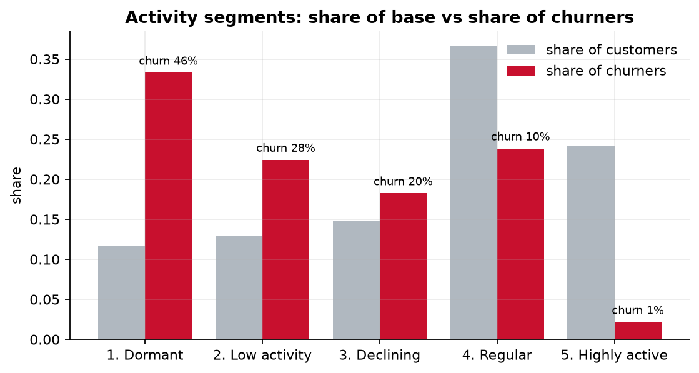
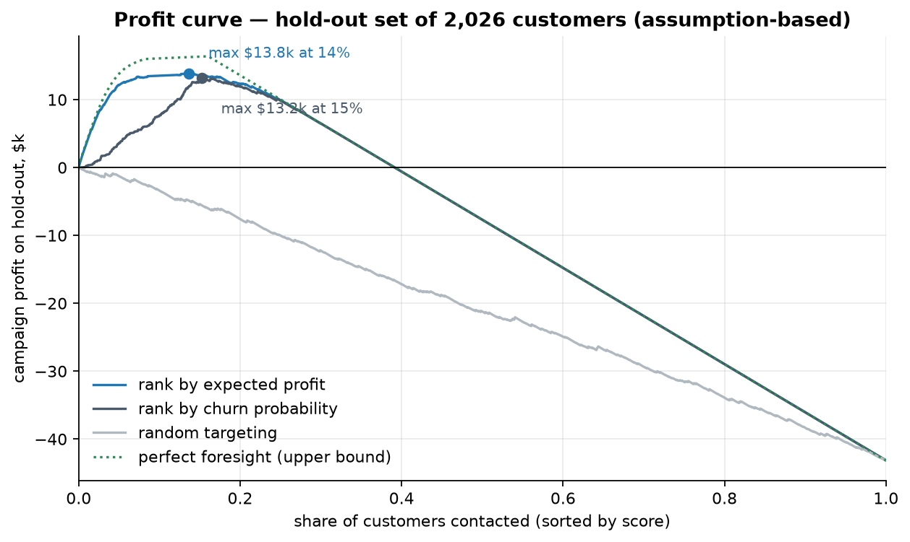
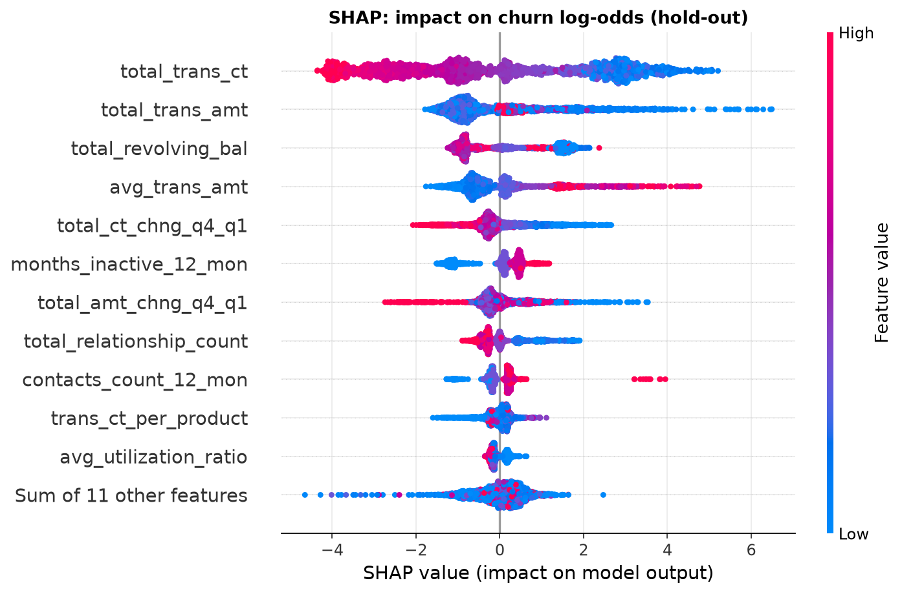
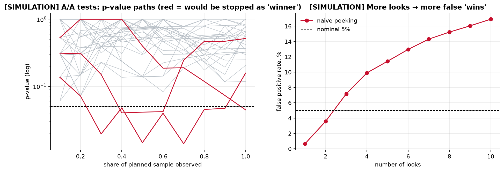

# Bank Customer Churn Prediction & Retention Campaign Optimisation

End-to-end churn project for a credit-card portfolio: SQL analytics → statistical
hypothesis tests → calibrated CatBoost model with SHAP → profit-based campaign
sizing → A/B test design with simulation → next-best-action rules → batch scoring
with drift monitoring → business deck and scoring dashboard.

> **Data:** Kaggle [*Credit Card Customers*](https://www.kaggle.com/datasets/sakshigoyal7/credit-card-customers) (`BankChurners.csv`, licence CC0: Public Domain), 10,127 customers,
> one row per customer (a single snapshot), 16.1% churned.
> **Money figures are illustrative.** The dataset has no revenue or cost data;
> every monetary result rests on explicit assumptions in
> [`config/config.yaml`](config/config.yaml) and is stress-tested below.
> **A/B results are simulated**, not observed.

---

## Executive summary

**Problem.** The bank lost **16% of its card customers** (1,627 of 10,127) in a year.
A retention campaign can save some of them, but contacting everyone wastes money:
most customers would stay anyway, and each contact plus offer costs ≈ $35.

**Solution.**
1. A **churn risk score** (CatBoost, calibrated) for every customer. On 2,026 held-out
   customers, calling the riskiest **10% reaches 62% of all leavers** (the ceiling is 62%,
   because leavers are 16% of the base), against **42% with simple SQL rules** and
   10% with random calling.
2. A **profit rule**: contact a customer only if *P(churn) × save rate × customer value >
   cost of contact*. That selects **~14% of customers**.
3. A **next-best-action** layer: every targeted customer gets a reactivation offer, and 88%
   also get a second offer tailored to their next risk signal (instalment plan, second
   product, credit review, service call).
4. A **pilot A/B test** design that measures the one number we don't know: the save rate.

**Impact (under the stated assumptions).**

| Strategy | Customers called | Profit per 10k customers |
|---|---|---|
| **Profit rule** (`E[profit] > 0`) | 14.5% | **≈ $68k** |
| Score ≥ 0.5 | 15.1% | ≈ $64k |
| Call everyone | 100% | **≈ −$213k** |

The campaign **breaks even if at least ~11% of contacted leavers are saved**; the base
case assumes 25%. Over ±50% changes in the assumptions, the best achievable profit
ranges from about **$21k to $129k per 10k customers**.

**Recommendations.**
1. **Run the pilot first.** About 110 customers per group (contact vs. no contact) in the
   top-risk segment, 90-day churn as the metric, analysed **once** at the planned end.
   Peeking at the results daily would inflate false "wins" from 5% to ~17% (simulated).
2. **Target by expected profit, not a fixed score cut-off.** The rule re-sizes the
   campaign automatically when costs or customer value change.
3. **Act on behaviour, not demographics.** Falling usage, few products and no revolving
   balance drive churn; age, gender and income barely matter.
4. **Replace assumptions with data.** Use real customer P&L and the measured save rate,
   rebuild features on a strict time window, then move to uplift modelling.

📊 **Business deck:** [`reports/churn_retention_presentation.pptx`](reports/churn_retention_presentation.pptx) (8 slides, native editable charts)
🖥️ **Dashboard:** `make app` → score any customer, see why, get the recommended offer

---

## Results at a glance

| | |
|---|---|
|  |  |
|  |  |

---

## Technical part

### Repository structure

```
├── config/config.yaml        # seed, paths, ALL business & A/B assumptions
├── data/raw/BankChurners.csv # source data (two leaky columns dropped in code)
├── sql/                      # 8 analytical queries (PostgreSQL-compatible) + Postgres schema
├── src/                      # all logic as functions, imported by notebooks/app/tests
│   ├── data.py               #   loading, cleaning, feature engineering, DuckDB layer
│   ├── stats_tests.py        #   chi-square / Mann-Whitney / Welch + effect sizes + Holm
│   ├── modeling.py           #   pipelines, stratified CV, metrics, calibration, leakage checks
│   ├── business.py           #   CLV proxy, expected profit, profit curve, sensitivity
│   ├── ab_testing.py         #   power analysis, z-test, bootstrap, Monte-Carlo, peeking
│   ├── recommend.py          #   SHAP-driver-family → next-best-action rules
│   ├── score.py              #   batch-scoring CLI: CSV in → campaign list + drift check out
│   ├── monitoring.py         #   PSI drift (features + score), calibration by score band
│   ├── slides.py             #   collects deck numbers from reports/tables → pptx
│   └── load_postgres.py      #   optional PostgreSQL loader
├── notebooks/                # executed notebooks, run in order 01 → 06
├── reports/
│   ├── figures/  tables/     # every chart and number quoted anywhere
│   ├── deck/                 # pptxgenjs deck builder
│   └── churn_retention_presentation.pptx
├── app/streamlit_app.py      # scoring dashboard
├── models/                   # trained CatBoost + calibrator + training reference for drift
├── tests/                    # 14 tests: metrics, A/B maths, profit curve, PSI, scoring CLI, app
├── Dockerfile                # serving image: dashboard + batch-scoring CLI
└── .github/workflows/ci.yml  # SQL queries + tests, then image build + smoke tests, on every push
```

### Reproduce

```bash
make setup     # Python 3.12 venv + full lock file (+ npm install for the deck)
make all       # DuckDB → notebooks 01–06 → slides → tests
make app       # Streamlit dashboard
make score IN=new_customers.csv OUT=scored.csv   # monthly batch scoring
```

Or run the trained model in Docker, with no local Python setup:

```bash
docker build -t churn-scoring .
docker run --rm -p 8501:8501 churn-scoring            # dashboard on localhost:8501
docker run --rm -v "$PWD/data:/data" churn-scoring \
    python -m src.score --input /data/customers.csv --output /data/scored.csv
```

The image installs only the runtime dependencies (`requirements-serve.txt`) and ships
the committed model; notebooks, reports and tests stay out of it.

Every random step uses `seed: 42` from the config, every SQL `ORDER BY` / window has
a deterministic tie-breaker, and all numbers on the slides and in this README come from
`reports/tables/*.csv`. Two clean runs of `make all` produce byte-identical tables.
`requirements-lock.txt` pins the full environment; `requirements.txt` lists only the
direct dependencies.

### Why this dataset (and its two traps)

BankChurners fits the brief: a bank, a real churn label, behavioural and product
features, and a manageable size. Two traps, both handled:

* **Two `Naive_Bayes_Classifier_*` columns** are predictions of another model trained
  on the target: used alone they give AUC = 1.0. They are dropped at load time.
* **It is a snapshot, not a panel.** We don't know whether the 12-month behaviour was
  measured before the customer decided to leave. All 54 customers with 6 bank contacts
  churned (100%), which looks like contacts made *while* closing the account. This is
  why the AUC (0.99) is well above what real churn models reach (typically 0.75–0.85).
  See the leakage section.

### Stage 1 — SQL layer (DuckDB, PostgreSQL-compatible)

| Query | Technique | Used for |
|---|---|---|
| `01_churn_overview` | aggregates, `SUM() OVER ()` | headline numbers |
| `02_churn_by_segment` | `GROUPING SETS` | demographics barely matter |
| `03_activity_segmentation` | `CASE` segmentation, window shares | slide 2: 25% of customers produce 56% of leavers |
| `04_spend_deciles_ntile` | `NTILE(10)` | non-monotone spend effect → tree model |
| `05_rank_segments` | `RANK`, `DENSE_RANK … PARTITION BY` | micro-segment ranking |
| `06_inactivity_lag` | `LAG` | reactivation trigger at month 2 |
| `07_product_holding_cte` | chained CTEs | cross-sell pool |
| `08_risk_flags_cte` | CTE + cumulative windows | rule-based benchmark the model must beat |

I used DuckDB so the project runs with no database server. `sql/00_schema_postgres.sql`
plus `python -m src.load_postgres` run the same queries on PostgreSQL.

### Stage 2 — Hypotheses (Holm-corrected, effect sizes reported)

| Hypothesis | Test | Effect | Result |
|---|---|---|---|
| H1 Transaction-count drop → churn | Mann-Whitney U | rank-biserial r = −0.49 (medium) | ✅ churn 36% vs 8% when count fell 40%+ |
| H2 1–2 products → churn | χ² | Cramér's V = 0.15 (small) | ✅ 27% vs 13% |
| H3 Zero revolving balance → churn | χ² | Cramér's V = 0.31 (medium) | ✅ 36% vs 10% |
| H4 3+ inactive months → churn | χ² | Cramér's V = 0.15 (small) | ✅ 22% vs 11% |
| H5 Age differs | Welch t-test | Cohen's d = 0.05 (negligible), p = 0.058 | ❌ not supported |

A finding counts as *actionable* only if it is significant after correction **and**
its effect is at least small. With n = 10k, p-values alone would call almost
anything significant.

### Stage 3 — Model

Stratified 80/20 split; 5-fold stratified CV on the training part only.

| Model (CV, mean ± sd) | ROC-AUC | PR-AUC | recall@top10% | Brier |
|---|---|---|---|---|
| Logistic regression (balanced) | 0.943 ± 0.007 | 0.806 ± 0.014 | 0.541 | 0.095 |
| Logistic regression (unweighted) | 0.943 ± 0.005 | 0.814 ± 0.011 | 0.547 | 0.061 |
| LightGBM | 0.994 ± 0.002 | 0.972 ± 0.007 | 0.615 | 0.021 |
| **CatBoost depth 6** | **0.994 ± 0.001** | **0.972 ± 0.005** | **0.614** | **0.020** |
| CatBoost depth 6, balanced weights | 0.994 ± 0.001 | 0.972 ± 0.005 | 0.614 | 0.020 |

Hold-out (2,026 customers): **CatBoost + Platt — ROC-AUC 0.993, PR-AUC 0.970,
recall@top10% 0.62, precision@top10% 0.995, ECE 0.005.** CV and hold-out differ by
less than 0.01 on every metric.

* **Why not accuracy:** a model that predicts "nobody churns" scores 84% accuracy and
  catches no one.
* **Imbalance:** handled with stratification, PR-AUC/recall@k and a profit threshold.
  Class weights brought no ranking gain. They hurt the calibration of logistic regression
  (ECE 0.12) and made no difference for CatBoost, so the final model is unweighted.
* **Calibration:** calibrators are fitted on *out-of-fold* scores. The method is
  **chosen without the test set**: a second CV over the OOF scores compares no
  calibration, Platt and isotonic (Brier 0.0201 / 0.0197 / 0.0198) and picks Platt.
  On the hold-out, Platt halves the ECE of raw CatBoost (0.011 → 0.005). The real
  lesson is the balanced logistic regression: when it says 50%, about 15% of those
  customers churn.
* **Leakage checks:** leaky columns removed; single-feature AUC scan (max 0.80);
  preprocessing inside pipelines; test set used once. Removing `contacts_count_12_mon`
  barely changes the scores (AUC 0.993 → 0.993).
* **SHAP:** transaction count dominates. The spend effect is non-monotone, and revolving
  balance is **U-shaped**: both zero and maxed-out ($2,517) balances raise risk.

### Stage 4 — Business layer

`E[profit_i] = P(churn_i) × save_rate × CLV_i − (contact_cost + accept_rate × incentive)`

* CLV proxy = 2 years × (1.5% interchange on spend + 15% margin on revolving balance), with a $150 floor.
* The campaign size is chosen **without tuning on the test set**: Rule A (`E[profit] > 0`)
  needs no tuning; Rule B picks k on out-of-fold training predictions. They land 0.9%
  and 1.8% below the optimistic test optimum.
* Ranking by expected profit beats ranking by probability, because churners are worth
  less on average ($342 vs $517 CLV).
* Sensitivity: save rate and CLV dominate (±50% gives $21k–$129k per 10k customers);
  costs matter far less. The profit curve is flat between 7% and 18% of customers
  called, so the exact size matters less than the save rate.
* Honest note: a 0.5 threshold is only ~5% worse *here*, because the model separates
  the classes so sharply. The profit rule pays off when the economics change.

### Stage 5 — A/B test (design + simulation)

* **Population:** customers selected by the profit rule. Randomise 50/50 into contact vs. no contact.
* **Metric:** 90-day churn. Guardrails: cost per saved customer, complaints.
* **MDE:** 15% relative reduction, set above the ~11% break-even. With a 91% baseline
  this needs **108 customers per arm** (statsmodels: 108, textbook formula: 111).
* **Monte Carlo (2,000 runs):** power 0.80 at the MDE, A/A false-positive rate 0.054.
* **Analysis:** two-proportion z-test + bootstrap CI + Fisher's exact test. Fisher is
  included because ~10 expected stayers in the control group makes the normal
  approximation borderline.
* **Peeking (20,000 runs, 10 looks):** stopping at the first p < 0.05 gives a 16.9%
  false-positive rate, against 5.2% for a single look. A simulation-calibrated
  Pocock-style boundary (p < 0.0157 per look) brings it back to 4.7% at a small cost in power.

### Stage 6 — Cross-sell / reactivation

SHAP values are summed into four actionable driver families: usage, products, balance
and service. The dominant family gives the primary offer, and the next family (if it
adds ≥ 0.25 log-odds of risk) gives a secondary one. Honest finding: low usage
dominates nearly every at-risk customer, so personalisation happens in the second layer:

| Secondary offer | Customers (hold-out campaign) |
|---|---|
| Instalment plan / 0% balance transfer (zero balance) | 103 |
| Second product (1–2 products) | 69 |
| Credit-limit review or rate offer (revolving / maxed-out balance) | 62 |
| Senior-agent service call (many contacts) | 23 |

The 28 maxed-out customers have the highest value (≈ $866 CLV), the most valuable
group to keep.

### Stage 7 — Deployment & monitoring

* `python -m src.score --input customers.csv --output scored.csv` is the monthly batch
  job. It validates the input columns, scores customers, applies the profit rule and
  attaches offers. Before scoring, it prints a PSI drift report against the training data.
* Churn labels arrive ~90 days late, so monitoring watches **inputs and scores first**
  and calibration once labels mature (notebook 06, `reports/tables/monitoring_plan.csv`).
* **Simulated drift** (a competitor takes 40% of spending from 35% of customers): the
  quarter-on-quarter change features hit PSI 0.31–0.40 (alert), score PSI 0.33, and
  the campaign list grows from 14.5% to 34% of customers. Without monitoring, the
  budget would balloon silently. In the healthy hold-out month, every feature PSI is ≤ 0.012
  and the score PSI is 0.023.
* **Packaging:** the `Dockerfile` serves the dashboard and the batch job from one image.
  CI builds it on every push, scores the full dataset inside it and waits for the
  dashboard's health check.

### Limitations & next steps

* **Temporal design:** rebuild features from a window that ends before the prediction
  date (e.g. months −12…−1, label = churn in months 0…+3). Expect a lower AUC.
* **Economics:** replace the CLV proxy and costs with real P&L. Measure the save rate
  in the pilot.
* **Uplift modelling:** with pilot data, target customers the contact actually
  persuades, not merely the high-risk ones.
* **Hyper-parameters:** only tree depth was compared (4/6/8, all within noise); a small
  Optuna search is unlikely to matter here but would on harder real data.

## License

Code: [MIT](LICENSE). Data: Kaggle *Credit Card Customers*, CC0 (Public Domain).
